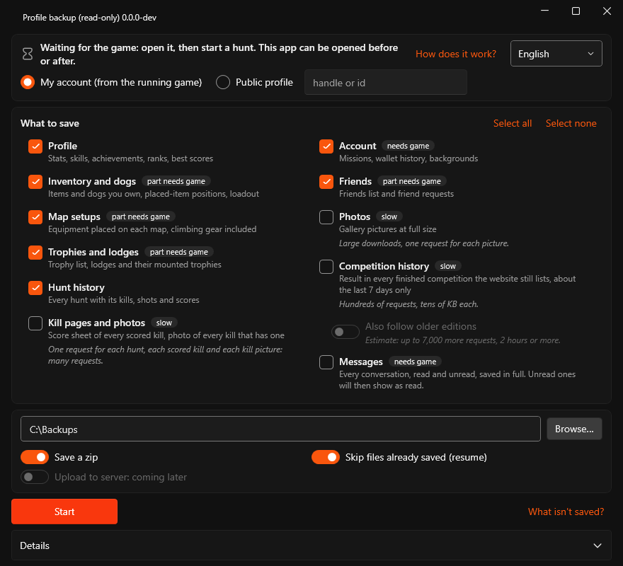
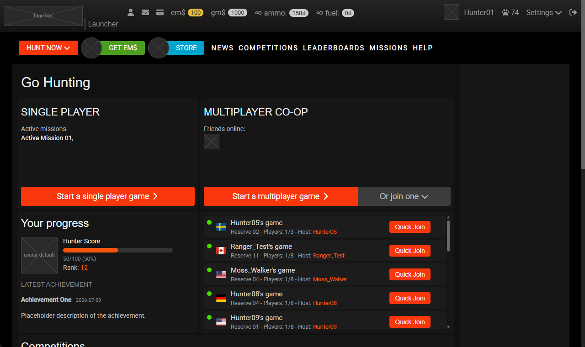

# Hunter Resurgence
[](https://github.com/yinyin99/hunter-resurgence/actions/workflows/ci.yml) [](https://github.com/yinyin99/hunter-resurgence/releases/latest) [](LICENSE)

Unofficial community server, launcher, website and profile backup tool for theHunter Classic, whose official servers close on 2026-11-11.

## Disclaimer

Unofficial fan project. Not affiliated with, endorsed by or connected to the developer or publisher of theHunter Classic. theHunter Classic is a trademark of its respective owner. This repository contains no game files or game data; you need your own copy of the game.

Licensed under the [GNU AGPL-3.0](LICENSE).

## For players: the backup tool

The backup tool is a small Windows app that saves your profile (statistics, inventory, trophies, hunt history and more) as files on your PC while the official servers are still up. It only reads; it changes nothing on the server. It speaks six languages and follows your Windows language. Details: [docs/backup.md](docs/backup.md); what it stores and sends: [privacy](docs/backup.md#privacy).



1. Download `backup-win-x64.zip` from the latest release and unpack it. Keep `backup.exe` and `settings.json` in the same folder.
2. Start `backup.exe`. For your own account, open the game and start a hunt (the backup tool can be open before or after); or choose "Public profile" and type a handle or id.
3. Tick what to save, press Start. The result is a backup folder and a backup zip in `Documents\game-backup` ([names](docs/backup.md#what-is-saved)). Keep that backup zip private.

### Windows SmartScreen and checking the download

**Windows SmartScreen.** The exe is not code-signed, so Windows may show "Windows protected your PC / Unknown publisher". Choose **More info**, then **Run anyway**.

**Check the download.** The release notes list the SHA-256 of the release zip. Compare it with yours:

```
Get-FileHash backup-win-x64.zip -Algorithm SHA256
```

If the two differ, do not run it.

To check that the release zip was built by this repository's release workflow from its public source, use the [GitHub CLI](https://cli.github.com/):

```
gh attestation verify backup-win-x64.zip -R yinyin99/hunter-resurgence
```

## Website (work in progress)

[hunter-resurgence.com](https://hunter-resurgence.com) shows the new website. It is a preview: every page shows fixed, fictional data (you start signed in as `Hunter01`; sign out in the top bar for the public site; sign-in accepts any email address and any six digits), pictures are labelled boxes, and a banner on every page says so. It is not the game server, and no data you enter is saved. Use a current Chrome or Edge with JavaScript. Details: [docs/website.md](docs/website.md).

## Roadmap

The official servers close on 2026-11-11. The game needs them even for single-player hunts. The first goal is to let you play offline again, with a local server on your own PC or local network, as soon as possible after that date; sharing a server, accounts and the new launcher follow. There are no dates, and the order can change when a step turns out easier or harder than expected.

Solo means a single-player hunt on a server; multiplayer means hunting with others; offline means a local server runs on your own PC or local network.

| Step | What it brings | State |
|---|---|---|
| Now | **Profile backup**: saves your profile while the official servers are still up. Keep the game installed (a server needs your copy), keep your backup zips private, and do not run any setup tool before the shutdown if you still want the official servers | Available ([above](#for-players-the-backup-tool)). Run it before 2026-11-11 |
| 1 | **Offline play**: run a local server on your own PC (or another PC on your local network) with your own copy of the game. For now, a one-time command-line setup edits your Windows hosts file and installs a local certificate for the game's addresses (the method may change); both can be removed again with one command. No launcher yet. You can restore your own backup zip (inventory, trophies, statistics, skills and wallet). Hunting, kills, harvest, score, gold and XP come first; missions, competitions, leaderboards and the trophy-lodge pages may be missing at first. The game's files stay unchanged | First, after the shutdown |
| 2 | **Remote play**: prove that the game can play on a community server over the internet, through a small helper on your PC | After step 1 |
| 3 | **Community server, accounts and restore**: a community server (the same code you can run yourself), sign in with your Steam account (email sign-in may follow), upload your backup zip to get your inventory, trophies, statistics, skills and wallet back; missions later | Planned |
| 4 | **New launcher**: sign in, choose a server, start a hunt, change the game settings; Steam's Play button opens it once you set a Steam launch option | In development: the screens and the game settings editor work, with mock data; no download yet |
| 5 | **New website**: profiles, trophies, hunt history with kill pages, leaderboards; then the store (in-game currency only; no money, ever: no donations, no ads, nothing is sold), missions and friends | Work in progress: the screens are live with mock data ([preview](#website-work-in-progress)); real data needs the community server |
| Later | Trophy lodge and bait-site pages inside the game, multiplayer, competitions | - |



*New launcher (step 4): work in progress, mock data, images are placeholders.*

### What a restore can bring back

A restore can only bring back what the backup saved ([what is not saved](docs/backup.md#what-is-not-saved)). The claim key in the backup zip and the Steam account recorded by a backup made in **My account** mode are only hints that a backup is yours; if two people claim the same profile, the claim may be reviewed ([claim key](docs/backup.md#claim-key)).

## No money, ever

This project and the community server run by its maintainer take no donations (not even for hosting), have no paid tier, no ads, no sales of items or currency and no perks. The only currency is the in-game one.

## Help wanted: translators

Native speakers can check the backup tool's texts in its 5 non-English languages (`tools/backup/Strings.*.resx`) and the launcher's and website's texts in their 18 non-English languages (`src/Ui/Strings.*.resx`, list in `src/Ui/Languages.cs`). A test checks that each set has the same keys and `{0}` placeholders ([backup tool](docs/backup.md#languages), [launcher and website](docs/launcher.md#languages)). Open an issue or a pull request.

## Documentation

- [CONTRIBUTING.md](CONTRIBUTING.md): rules, build, test, releases and CI.
- [GLOSSARY.md](GLOSSARY.md): the project's words.
- [AGENTS.md](AGENTS.md): where things are and the working rules for coding agents.
- [docs/backup.md](docs/backup.md): the backup tool.
- [docs/launcher.md](docs/launcher.md): the launcher.
- [docs/website.md](docs/website.md): the website and the shared UI library.
- [docs/restore.md](docs/restore.md): the restore library.
- [docs/deploy.md](docs/deploy.md): the website's container image and deploy.
- [THIRD-PARTY-NOTICES.md](THIRD-PARTY-NOTICES.md): the third-party fonts, icons, flags and libraries bundled in the website, launcher and backup tool, and their licences.
