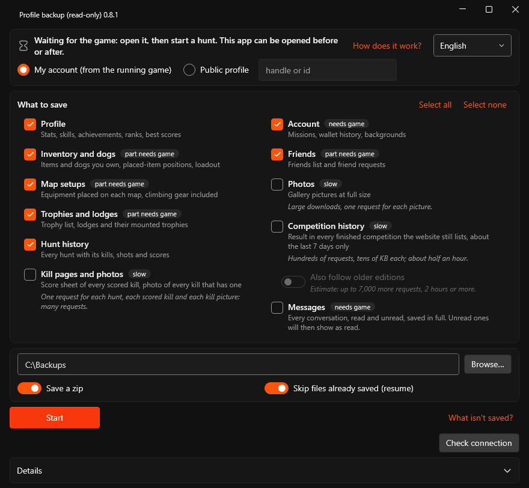
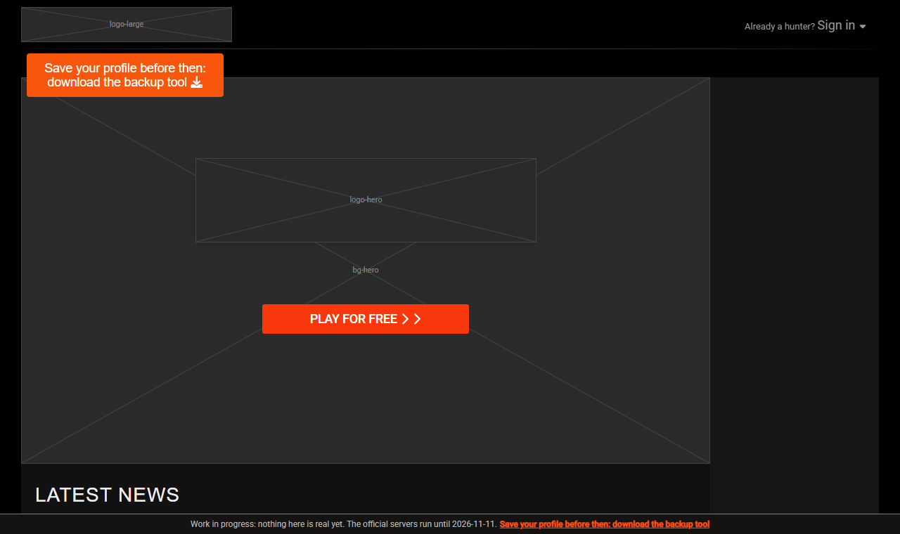
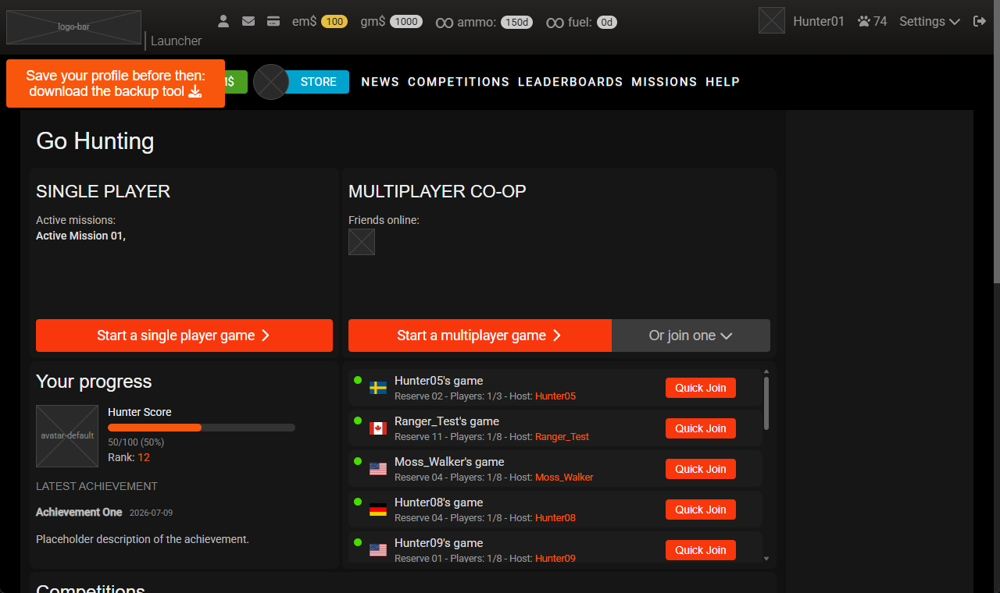

# Hunter Resurgence: community server for theHunter Classic

**Website preview: [hunter-resurgence.com](https://hunter-resurgence.com)** (mostly fictional data, not the game server: [what you can try](#website-preview))

  

Unofficial community server, launcher, website and profile backup tool for theHunter Classic, whose official servers close on 2026-11-11.

After that date the game stops working, even for a single-player hunt, because it needs those servers. This project is building a community server so you can keep playing, with your profile (statistics, inventory, trophies and more) brought back from a backup. Running the same server on your own PC for offline play is planned; hunting with other players comes later. You need your own copy of the game: this project contains no game files.

> [!IMPORTANT]
> **Save your profile with the [backup tool](#for-players-the-backup-tool) before 2026-11-11** (download it from the [latest release](https://github.com/yinyin99/hunter-resurgence/releases/latest)). It needs the official servers, so after that date it cannot save anything, and a restore can only bring back what a backup saved. Keep the game installed: you will play with your copy, on the community server or on a server on your own PC.

**New here? [The player guide](docs/guide.md) takes you from backup to playing on the community server, step by step.**

## For players: the backup tool

The backup tool is a small Windows app that saves your profile (statistics, inventory, trophies, hunt history and more) as files on your PC while the official servers are still up. It only reads; it changes nothing on the server. Your backup stays on your PC: the tool sends it to the community server only if you press "Send to the community server" after a backup ([how](docs/backup.md#send-to-the-community-server)). Its window follows your Windows language (English, French, Spanish, Portuguese, German or Russian).

1. Download `backup-win-x64.zip` from the latest release and unpack it. Keep `backup.exe` and `settings.json` in the same folder.
2. Start `backup.exe`. For your own account, open the game and start a hunt (the backup tool can be open before or after); or choose "Public profile" and type a handle or id.
3. Tick what to save, press Start. The result is a backup folder and a backup zip in `Documents\game-backup` ([names](docs/backup.md#what-is-saved)). Keep that backup zip private.

"Check connection" says whether the official servers answer. If it says "redirected", the [player kit](#for-players-the-player-kit) is installed: remove it (`3-remove.cmd`) before a backup, because the backup tool needs the official servers.

**Windows SmartScreen.** The exe is not code-signed, so Windows may show "Windows protected your PC / Unknown publisher". Choose **More info**, then **Run anyway**.

The source is public, and you can check in a minute that your download is the real one: compare its checksum, as in [checking the download](docs/backup.md#checking-the-download).

Why a hunt: for your own account, the backup tool borrows the game's sign-in, and the game has one only once a hunt has started. A handle is a player's name in the game.

What it saves and what it does not: [docs/backup.md](docs/backup.md). What it keeps and sends: [privacy](docs/backup.md#privacy).

## For players: the player kit

The player kit connects your game to the community server over the internet. Download `play-win-x64.zip` from the [latest release](https://github.com/yinyin99/hunter-resurgence/releases/latest).

- A one-time setup edits the Windows hosts file so that the game's server names lead to a small forwarder on your PC, and trusts a local certificate that is good only for those names. The forwarder stays open while you play and passes everything on to the community server.
- It never changes the game's files. One script in the kit, `3-remove.cmd`, undoes everything and gives the official servers back.
- While it is installed, the game talks only to the community server. **Make your backup first**: the backup tool needs the official servers.

Steps, what it changes and what to do when something fails: [docs/play.md](docs/play.md). The whole way from backup to playing: [the player guide](docs/guide.md).

## No money, ever

This project and the community server run by its maintainer take no donations (not even for hosting), have no paid tier, no ads, no sales of items or currency and no perks. The only currency is the in-game one.

## Roadmap

Released today: the backup tool, and the player kit, which lets you play on the community server while it is still being built. There are no dates, and the order can change when a step turns out easier or harder than expected.

1. **Profile backup** (available now; run it before 2026-11-11): the [backup tool](#for-players-the-backup-tool).
2. **Community server, accounts and restore** (in progress; the server is built, see [docs/server.md](docs/server.md)).
   - Sign in with a Steam account (email sign-in may follow).
   - Restore: upload your backup zip on the website. Once the operator (the person who runs the server) approves it, you get your inventory, trophies, statistics, skills and wallet back. Nothing is restored automatically.
   - What works: hunting, kills, harvest, score, gold and XP. Missions, competitions, leaderboards and the trophy-lodge pages may be missing at first, and there is no seasonal event by default.
   - A restore brings back only what the backup saved ([what is not saved](docs/backup.md#what-is-not-saved)). The [claim key](docs/backup.md#claim-key) in a backup is a hint that it is yours, not proof.
3. **Offline play** (planned): the same server on your own PC or local network.
4. **Remote play** (available now, early): playing on the community server over the internet, with the [player kit](#for-players-the-player-kit).
5. **New launcher** (in development, no download yet; the game settings editor works, the rest shows sample data; [screenshot below](#launcher-preview)): sign in, choose a server, start a hunt, change the game settings. Steam's Play button opens it once you set a [Steam launch option](docs/launcher.md#start-it-from-steam).
6. **New website** (preview online, partly real): the store with buying in em$, the news, the hunterscore and minigame boards; still sample data: the fictional hunters' profiles, trophies and hunt history; missions and friends are not offered yet.
7. **Later**: the trophy lodge and bait-site pages inside the game, multiplayer, competitions.

### Website preview

[hunter-resurgence.com](https://hunter-resurgence.com) shows the new website. The real parts: sign-in with Steam; the store, with buying in em$ for a signed-in player; the news; the hunterscore and minigame boards; and the restore page, where a signed-in player can upload a backup zip for the operator's review. The server keeps your Steam id, your handle, your purchases and every zip you upload; the "Your data" page in the footer says what it keeps and how to delete it. Pages without a source on the server are hidden or still show fixed, fictional data ([known limits](docs/deploy.md#known-limits)), and pictures are the operator's own where it has them, labelled boxes elsewhere (the repository holds none; [docs/images.md](docs/images.md)). Works in a current Chrome or Edge. Details: [docs/website.md](docs/website.md).

*The website: sample data, placeholder images.*

### Launcher preview

*The new launcher: sample data, placeholder images.*

## Help wanted: translators

Native speakers can check the translations of the backup tool (5 languages besides English), the player kit (5) and the launcher and website (18). Open an issue or a pull request. How the texts work: [backup tool](docs/backup.md#languages), [player kit](docs/play.md#languages), [launcher and website](docs/launcher.md#languages).

## For contributors

Build, test, the repository's rules and releases: [CONTRIBUTING.md](CONTRIBUTING.md). The project's words: [GLOSSARY.md](GLOSSARY.md). AI coding agents start at [AGENTS.md](AGENTS.md).

One document per part:

- [docs/guide.md](docs/guide.md): the player guide, from backup to playing on the community server.
- [docs/backup.md](docs/backup.md): the backup tool.
- [docs/play.md](docs/play.md): the player kit.
- [docs/launcher.md](docs/launcher.md): the launcher.
- [docs/website.md](docs/website.md): the website and the shared UI library.
- [docs/restore.md](docs/restore.md): the restore library.
- [docs/server.md](docs/server.md): the server (local and community).
- [docs/deploy.md](docs/deploy.md): the website's container image and deploy.
- [THIRD-PARTY-NOTICES.md](THIRD-PARTY-NOTICES.md): the third-party fonts, icons, flags and libraries bundled in the website, launcher, backup tool and server, and their licences.

## Disclaimer and license

Unofficial fan project. Not affiliated with, endorsed by or connected to the developer or publisher of theHunter Classic. theHunter Classic is a trademark of its respective owner. This repository contains no game files or game data; you need your own copy of the game.

Copyright (C) 2026 the Hunter Resurgence project, [yinyin99](https://github.com/yinyin99). Licensed under the [GNU AGPL-3.0](LICENSE): copies and modified versions keep this notice.

Additional term under section 7(b) of the AGPL-3.0: copies and modified versions of the website and the launcher must keep the attribution "Hunter Resurgence © yinyin99", linked to https://github.com/yinyin99/hunter-resurgence, in the footer where this project shows it (or, if the footer is removed, as visibly in the program's legal notices).
